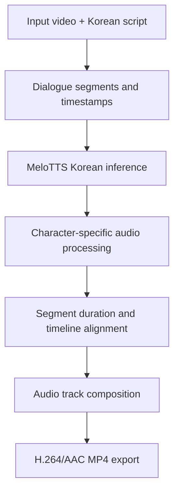

<div align="center">

# 🎬 Personalized AI Shorts

### Character-Aware Korean Voice Styling for Short-Form Comedy

**MeloTTS · Python · FFmpeg · Docker · Korean TTS**

*캐릭터별 음성 특징을 조절하여 짧은 코미디 영상에 적용하는 한국어 음성 합성 실험 프로젝트*

[▶ Watch Episode 01 on YouTube](https://youtube.com/shorts/fnZh7C9Cs44) · [MeloTTS](https://github.com/myshell-ai/MeloTTS)

</div>

---

## 🎥 Demo | Episode 01: 엄지와 소시지

[](https://youtube.com/shorts/fnZh7C9Cs44)

**[▶ YouTube Shorts에서 소리와 함께 보기](https://youtube.com/shorts/fnZh7C9Cs44)**

| 캐릭터 | 음성 스타일 | 장면에서 의도한 효과 |
|---|---|---|
| 🌭 소시지 | 상대적으로 높은 피치, 빠른 발화 | 신난 듯한 과장된 대사 |
| 👍 엄지 | 상대적으로 낮은 피치, 느린 반응 | 황당하고 어이없는 코미디 리듬 |

> **Note:** 감정 분류/감정 생성 모델을 학습한 프로젝트는 아닙니다. MeloTTS 음성에 신호 처리를 적용해 캐릭터별 *감정처럼 들리는 스타일*을 연출한 프로토타입입니다.

## 🔎 Project Overview

동일한 한국어 TTS 화자를 사용하더라도 캐릭터에 따라 **음높이(pitch)**, **발화 속도(tempo)**, **음량(gain)**, **대사 시작 시점(timing)**을 다르게 적용하면 청자가 구분할 수 있는 캐릭터 보이스를 연출할 수 있습니다.

이 프로젝트는 24초 세로형 영상(540 × 960)을 대상으로, 영상의 기존 프레임과 자막을 유지한 채 한국어 대사를 생성하고 구간별 음성을 배치하는 제작 과정을 다룹니다.

### Technical Stack

| 구분 | 기술 | 역할 |
|---|---|---|
| Language | Python | TTS 호출 및 대사 처리 |
| Text-to-Speech | [MyShell MeloTTS](https://github.com/myshell-ai/MeloTTS) | 한국어 음성 생성 |
| Audio processing | FFmpeg (`asetrate`, `aresample`, `atempo`, `volume`, `alimiter`) | 음색/속도/음량 조절 |
| Video composition | FFmpeg (`atrim`, `concat`, AAC, MP4) | 시간 구간 합성 및 영상 출력 |
| Environment | Docker / Linux | 실행 환경 격리 |

## ⚙️ Processing Pipeline



### 1. Segment-based dialogue modeling

각 대사를 **시작 시간, 종료 시간, 텍스트, 캐릭터** 단위로 관리합니다. 이를 통해 음성 구간과 영상 자막의 위치를 맞추고, 캐릭터별 후처리 설정을 달리 적용할 수 있습니다.

예시 구간(대략적인 편집 기준):

| Video time | Speaker | Role |
|---|---|---|
| 0.0–2.1 s | Narrator | 도입 |
| 2.1–4.5 s | Sausage | 신나는 외침 |
| 4.5–6.5 s | Thumb | 당황스러운 반응 |
| 6.5–24.0 s | Mixed | 나머지 대사와 다음 화 예고 |

### 2. Character-aware audio transformation

단일 한국어 화자의 MeloTTS 출력을 기반으로 FFmpeg 후처리를 사용했습니다.

- **Pitch:** 샘플레이트를 재해석하는 `asetrate` 방식으로 상대적인 음높이를 조정
- **Tempo:** `atempo` 및 구간 길이 정렬로 대사 속도를 조절
- **Loudness:** `volume`, `alimiter`로 음량과 피크를 제어
- **Alignment:** 구간 추출, 길이 보정, 이어 붙이기를 통해 24초 타임라인에 배치

예시 — 입력 오디오가 **24,000 Hz**일 때 소시지 음성을 높이는 테스트:

```bash
ffmpeg -y -i sausage_source.wav \
  -af "asetrate=28800,aresample=24000,volume=1.5,alimiter=limit=0.95" \
  sausage_styled.wav
```

`asetrate`는 음높이와 재생 시간을 **동시에** 바꿉니다. 실제 타임라인에 넣을 때에는 길이 보정이 필요합니다. 24,000 Hz는 프로젝트에서 확인한 음성 파일의 값이며 다른 소스에는 그대로 적용하면 안 됩니다.

### 3. Video export and verification

- 음성 트랙을 MP4에 AAC로 인코딩
- 기존 영상 프레임 유지 또는 호환성이 필요한 경우 H.264 재인코딩
- `ffprobe`로 스트림·길이 확인, 음성 추출 및 청취로 결과 검증

## 🚀 Getting Started

### Requirements

- Linux / Docker 권장
- Python 3.10 권장, Git, FFmpeg / FFprobe
- 최초 모델 설치·다운로드 시 인터넷 연결
- `input.mp4` — 24초, 540 × 960 영상 (원본 권리 확보 필요)

```bash
cd /workspace/finger_tts_melotts
bash setup_and_run.sh
```

> `setup_and_run.sh`는 프로젝트 환경에 맞춰 작성된 스크립트입니다. **공개 저장소에 음성 생성 코드와 입력 영상이 포함되지 않은 경우 이 명령만으로 데모를 재현할 수 없습니다.** 실행 스크립트의 의존 파일과 경로를 먼저 확인하세요.

기존 작업에서 사용한 주요 출력 이름:

```text
final_korean_voice.mp4   # 기본 한국어 TTS 합성 결과
korean_dialogue_only.wav # 전체 대사 오디오
generated_voice/         # 대사별 생성 파일
```

실험 과정에서 후처리된 음성은 별도 트랙으로 합성했습니다. 최종 배포 영상은 상단 YouTube 데모를 참조하세요.

## 🧪 Engineering Notes & Limitations

**What worked**

- 한국어 TTS 기반 짧은 대사 생성
- 캐릭터별 음높이/속도 대비를 활용한 코미디 보이스 연출
- FFmpeg 기반 음성 구간 편집 및 MP4 오디오 삽입
- Docker 환경에서 제작 및 검증

**Current limitations**

- MeloTTS 자체가 신남·황당함 같은 감정을 직접 제어하는 것은 아님
- 신호 처리만으로 사람 성우의 자연스러운 감정 억양을 복원할 수 없음
- 피치/속도 변화에 따른 타임라인 싱크 재조정 필요
- 24초 고정 영상의 장면 길이가 대사 표현 범위를 제한함

## 🗺️ Roadmap

- [ ] 대사·화자·효과 설정을 하나의 구성 파일로 통합
- [ ] 감정 스타일 프리셋 자동 적용
- [ ] 음량 정규화 및 대사 싱크 자동 검증
- [ ] 감정 표현형 TTS와 현재 후처리 방식의 비교 실험
- [ ] 대본 생성부터 최종 렌더링까지의 단계별 자동화

위 항목들은 **향후 계획**이며 현재 구현 완료 기능은 아닙니다.

## 📜 Licenses & Media Rights

- [MeloTTS](https://github.com/myshell-ai/MeloTTS): MIT License
- [MeloTTS-Korean checkpoint](https://huggingface.co/myshell-ai/MeloTTS-Korean): MIT로 표시됨
- FFmpeg: 실제 사용한 빌드 구성과 배포 방식에 따라 적용되는 라이선스 조건 확인 필요
- 영상·이미지·음성·폰트 등 개별 에셋의 권리는 별도로 확인해야 함
- 타사 음악은 이 데모에 사용하지 않았다는 제작 기준을 따름

## 🔗 Links

- **[YouTube Shorts — Episode 01](https://youtube.com/shorts/fnZh7C9Cs44)**
- [MeloTTS official repository](https://github.com/myshell-ai/MeloTTS)

---

<div align="center">

*An experimental portfolio project exploring lightweight, character-specific Korean voice production.*

</div>

